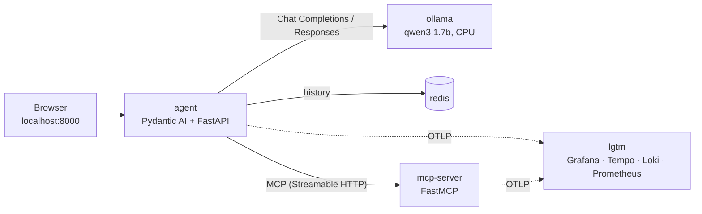

# Stack It Yourself: Open Infrastructure for AI Agents, from Compose to Cluster

Companion repo for the *Stack It Yourself* hands-on workshop, first delivered at AGNTCon + MCPCon North America 2026.

You build an AI agent on open infrastructure: local inference through an OpenAI-compatible server, OpenTelemetry traces, metrics and logs in Grafana, durable history in Redis, tools over MCP - then you move the same containers to Kubernetes. **No GPU, no cloud account, no proprietary API key.**

> **Before the workshop:** follow [prerequisites.md](prerequisites.md). It takes about 15 minutes on good Wi-Fi and can't be done on conference Wi-Fi.



## The steps

Every step is the same two moves. **The code never changes - only `.env` does.**

```bash
cp env/stepN.env .env
docker compose up -d
```

| Step | What changes in `.env` | Open | What you'll see |
|---|---|---|---|
| **1** Baseline | - | http://localhost:8000 | An agent on local inference - `OllamaModel`, **Chat Completions** |
| **2** Modern API | `MODEL=openai-responses:...` | http://localhost:8000 | Same server, **Responses API** - one line changed |
| **3** Observability | + `observability` profile, `OTEL_SDK_DISABLED=false` | http://localhost:3000 | The agent loop as a trace; GenAI token metrics; logs linked to traces |
| **4** Durable history | + `state` profile, `HISTORY_BACKEND=redis` | the agent UI | Destroy the container - the conversation survives |
| **5** Tools + MCP | + `tools` profile, `TOOLS=local,mcp` | Grafana | **One trace spanning two processes** (MCP SEP-414) |
| **6** Compose → cluster | `./scripts/cluster-up.sh` | http://localhost:8081 · :3001 | Same image, same traces, three replicas, one conversation |

See exactly what a step turns on: `git diff --no-index env/step2.env env/step3.env`

Fallen behind? Copy the step's file and run `docker compose up -d` - you're back with the room.

## How the pieces fit

**The model string picks the API surface.** Pydantic AI resolves `<provider>:<model>`:

| `MODEL=` | Pydantic AI class | API it speaks |
|---|---|---|
| `ollama:qwen3:1.7b` | `OllamaModel` | Chat Completions |
| `openai-responses:qwen3:1.7b` | `OpenAIResponsesModel` | Responses |
| `openai-chat:Qwen3-1.7B` | `OpenAIChatModel` | Chat Completions |

**"OpenAI-compatible" is a spectrum, not a guarantee.** Ollama speaks both surfaces, and so does vLLM. Some hosted catalog models speak only Chat Completions and answer the Responses API with `400`. Step 2 shows this live.

**Telemetry is standard OpenTelemetry.** The agent calls `Agent.instrument_all()` once, and `opentelemetry-instrument` wires the SDK from standard `OTEL_*` variables. There's no vendor SDK and no account. Spans follow the [OpenTelemetry GenAI semantic conventions](https://opentelemetry.io/docs/specs/semconv/gen-ai/). FastMCP carries the trace into the MCP server through the request's `_meta` field, per [SEP-414](https://modelcontextprotocol.io/seps/414-request-meta).

**History sits behind a serialization boundary.** [`agent/app/history.py`](agent/app/history.py) stores each turn with Pydantic AI's `ModelMessagesTypeAdapter`. The in-memory store dies with the container; the Redis store doesn't. Which one runs is configuration.

## Repo map

```text
compose.yaml             the whole stack; services gated by profiles
env/step1..5.env         one known-good configuration per step
env/hosted.env.example   hosted fallback (copy to env/hosted.env)
agent/                   Pydantic AI agent behind FastAPI, with a small browser UI
mcp-server/              FastMCP server: a conference workshop schedule (the demo data)
images/ollama-cpu/       official Ollama binary, CPU backends only (~54 MB vs 3.75 GB)
grafana/dashboards/      the workshop dashboard, provisioned into Grafana
k8s/                     kind cluster + manifests for Step 6
scripts/                 preflight, offline bundle, cluster up/down (bash + PowerShell)
```

## Configuration reference

| Variable | Values | Default |
|---|---|---|
| `MODEL` | `ollama:<m>` · `openai-responses:<m>` · `openai-chat:<m>` | `ollama:qwen3:1.7b` |
| `OPENAI_BASE_URL` / `OPENAI_API_KEY` | any OpenAI-compatible endpoint | Ollama in Compose |
| `REASONING` | `off` (sends `openai_reasoning_effort=none`) · `default` | `off` |
| `HISTORY_BACKEND` | `memory` · `redis` | `memory` |
| `TOOLS` | comma list of `local`, `mcp` | none |
| `OTEL_SDK_DISABLED` | `true` · `false` | `true` |
| `CAPTURE_CONTENT` | `true` puts prompts and completions in spans - dev only | `true` |
| `COMPOSE_PROFILES` | `observability`, `state`, `tools` | none |

## Every component is open source

| Component | Licence |
|---|---|
| Pydantic AI, FastAPI, redis-py, Ollama | MIT |
| FastMCP, OpenTelemetry, Prometheus, kind, Kubernetes, **Qwen3 weights** | Apache-2.0 |
| Grafana, Loki, Tempo | AGPL-3.0 |
| Redis 8 | AGPL-3.0 (one of its three licence options) |
| This repo | [MIT](LICENSE) |

## Running this workshop yourself

- **Publish the images first.** Tag a release, and [`.github/workflows/publish-images.yml`](.github/workflows/publish-images.yml) builds multi-arch images and pushes them to GHCR. Make the packages public, then point `compose.yaml`'s `IMAGE_PREFIX` default at `ghcr.io/<owner>/stack-it-yourself`. Until you do, preflight builds the images locally, which downloads about 4 GB instead of about 0.2 GB. The default prefix `sit.local` is deliberately not a real registry, so a missing image can never be pulled from someone else's namespace.
- **Offline USB bundles:** on a machine that has passed preflight, run `./scripts/offline-bundle.sh export <dir>`. Attendees then run `import`, with no network needed.
- **Step 6:** `./scripts/cluster-up.sh` takes about five minutes the first time, so run it before you need it. It loads images from your local Docker cache into kind, so there are no registry pulls during the session.
- **Hosted fallback:** for attendees whose laptop can't run the model, [`env/hosted.env.example`](env/hosted.env.example) points at an **Azure AI Foundry** deployment of `Qwen3-1.7B`, the same tier everyone else runs locally. Deploy it ahead of time, hand out the endpoint and a key, and attendees copy the file to `env/hosted.env` and fill in those two values. It speaks Chat Completions only, hence the `openai-chat:` prefix. Any other OpenAI-compatible endpoint works too.
- **Reusing it for another event:** the demo data is event-specific. Replace `WORKSHOPS` and the server's `instructions` in [`mcp-server/server.py`](mcp-server/server.py), change the event name in the first sentence of both instruction strings in [`agent/app/assistant.py`](agent/app/assistant.py), and update the hint text in [`agent/app/static/index.html`](agent/app/static/index.html) and the example questions in [`CHEATSHEET.md`](CHEATSHEET.md). Nothing else is tied to one event.
